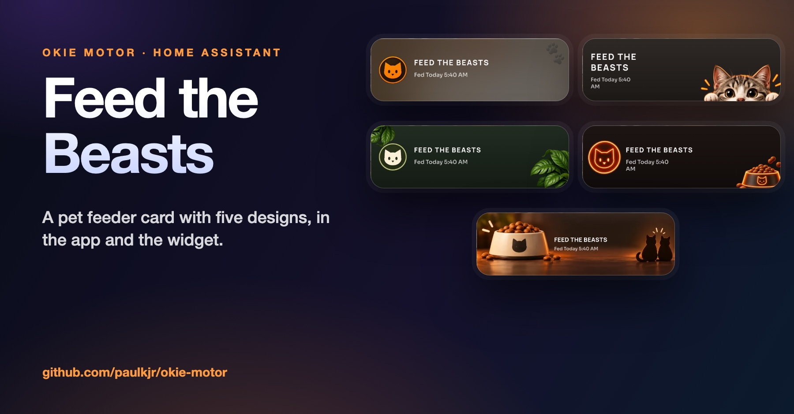
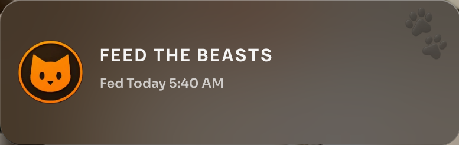
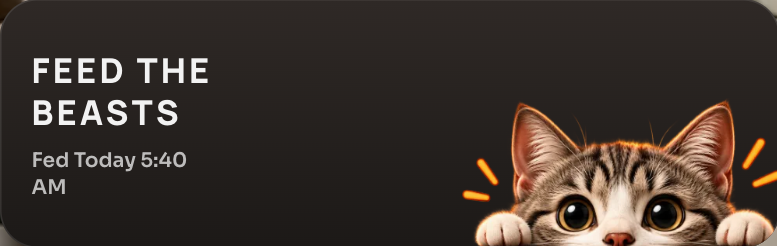
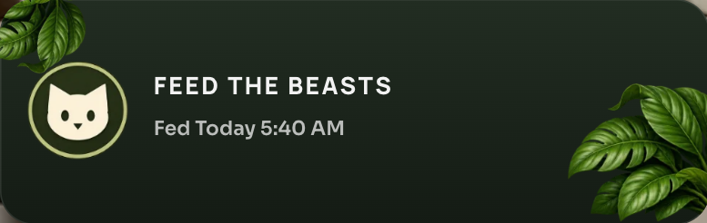
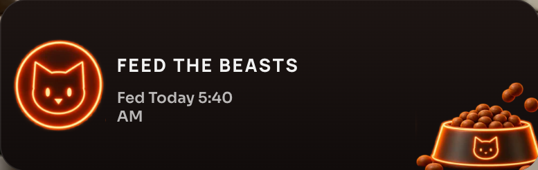
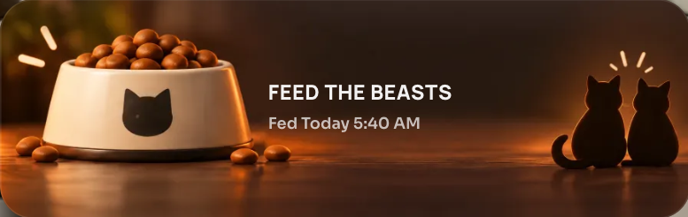

# Feed the Beasts

**A one-tap pet feeder card for Home Assistant, with five illustrated designs that are the same in the card and in the iPhone and iPad widget.**

> This repository is the project page. The code lives in **[Okie Motor](https://github.com/paulkjr/okie-motor)** (a dashboard card for Home Assistant, and a native iPhone and iPad app), where this part is one of the screens. The links below go to the exact files.

## What it does

* One tap runs your feeding script (the script of Home Assistant with feed in its id or name, or the one you choose) and the card shows when the pets were last fed
* If they were fed less than 10 minutes ago, the first tap only asks ("Tap again to feed anyway"), so a second person does not feed them twice
* Five illustrated designs: **Orange cat**, **Peeking cat**, **Green leaves**, **Neon bowl** and **Bowl**, plus a compact row. Pick one with the pencil on the card while you arrange the start screen, or in Settings
* The same five designs exist as a native widget in the iPhone and iPad app

## Screens

  
*Orange cat*

  
*Peeking cat*

  
*Green leaves*

  
*Neon bowl*

  
*Bowl*

## How it works

* **Drawn in the widget's own units.** The designs are laid out in the units of the widget (a card 158 high), with the pictures and the text hanging on the left or right edge, so a wider card just gets more room in the middle.
* **Small pictures.** The art is converted to small WebP images embedded in the card (about 150 KB for all five), with the exact placement, opacity and rotation of each picture kept in one table.
* **The text is the card's own** (Manrope and Sora), uppercase name with letter spacing, and the line under it turns into the accent colour when it asks you to tap again.
* **Tested.** Finding the script, reading when it last ran, the ten minute rule, the words ("Today 6:09 AM", "Yesterday", a weekday), the designs table and every picture it uses are covered by unit tests.

## Where the code is

| What | File |
|---|---|
| The card and its six looks | [`src/okie-feeder.js`](https://github.com/paulkjr/okie-motor/blob/v0.52.5/src/okie-feeder.js) |
| The pictures (generated) | [`src/okie-feeder-art.js`](https://github.com/paulkjr/okie-motor/blob/v0.52.5/src/okie-feeder-art.js) |
| Tests | [`tests/feeder.test.js`](https://github.com/paulkjr/okie-motor/blob/v0.52.5/tests/feeder.test.js) |
| iPhone / iPad: the card in SwiftUI | [`ios-app/Shared/FeederCard.swift`](https://github.com/paulkjr/okie-motor/blob/v0.52.5/ios-app/Shared/FeederCard.swift) |
| iPhone / iPad: the widget | [`ios-app/Widgets/FeederWidget.swift`](https://github.com/paulkjr/okie-motor/blob/v0.52.5/ios-app/Widgets/FeederWidget.swift) |
| iPhone / iPad: the design picker | [`ios-app/App/FeederSheet.swift`](https://github.com/paulkjr/okie-motor/blob/v0.52.5/ios-app/App/FeederSheet.swift) |

## Try it

* **Without installing anything:** download [`okie-demo.html`](https://github.com/paulkjr/okie-motor/releases/latest/download/okie-demo.html) and double-click it. It runs the whole card against a pretend Home Assistant.
* **In your Home Assistant:** add [paulkjr/okie-motor](https://github.com/paulkjr/okie-motor) as a custom repository in HACS (category Dashboard), or follow the [guides](https://github.com/paulkjr/okie-motor/tree/v0.52.5/docs/guides).

## Credits

* Original Fast Search concept and base implementation: [fastender](https://github.com/fastender) ([Fast Search Card](https://github.com/fastender/Fast-Search-Card))
* Hemma customization and ongoing tweaks: [willsanderson](https://github.com/willsanderson) ([Hemma](https://github.com/willsanderson/Hemma))

Okie Motor is an independent project, not made or endorsed by them. Built by directing Claude Code (an AI coding assistant): I design the screens and decide what ships, and every change is tested.

## Support

Enjoying this? Buy me a coffee, I wanna be a full time DJ/designer: https://ko-fi.com/paulkmusic

## Licence

GPL-3.0-or-later, like the rest of Okie Motor (see [LICENSE](LICENSE)).
